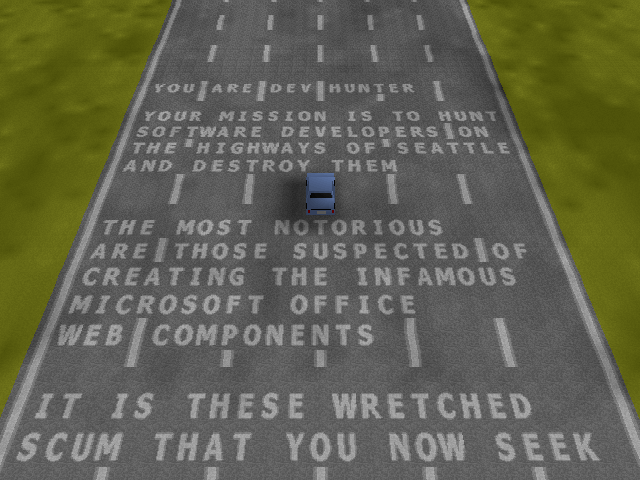

# Dev Hunter — standalone

A standalone native reimplementation of **Dev Hunter**, the hidden car‑shooter
easter egg in Microsoft Excel 2000 (`MSOWC.DLL`). You drive down a highway, the
names of the Excel 2000 developers scroll past painted on the road, and you hunt
and shoot the oncoming "developer" cars.

No Excel, no DirectDraw, no DLL required to run.



This is a **faithful translation of the original game code**, reverse‑engineered
from `MSOWC.DLL` and verified pixel‑for‑pixel against the real game (run live
under the Binary Ninja debugger). The perspective road renderer, the software
rasterizer, the player physics, the road/lane/barrier generation, the scrolling
dev‑name text, the car sprites, enemies and bullets are all translated from the
disassembly. See `REVERSE_ENGINEERING.md` for the teardown.

The original is C++ (an ActiveX/COM control; the game logic is methods on one
large `this` object), so the port is **C++** too: `devhunter.h` declares that
object as a `DevHunter` class whose member fields sit at their exact original
`this` offsets — each pinned by a `static_assert(offsetof(...) == 0xNNN)` so a
layout mistake can't compile. The game code then reads like `g->speed`,
`g->enemy[i].timer`, `g->texptr[cell]` instead of raw `*(this+0xNN)` offsets.
Every step of the C→C++/named‑field refactor was verified byte‑identical against
the prior build across a full day/night cycle (frames 120/2600/5200/9200) using
a deterministic `--shot` clock.

`init` (the one‑time, deterministic terrain/texture/letter‑atlas setup) is loaded
from a snapshot of its exact output (`init_state.bin`) rather than re‑derived —
byte‑identical and still standalone.

## Build

Needs MSVC (any recent Visual Studio). Builds **32‑bit** (the game stores 4‑byte
`this`‑relative pointers inside its own state).

```
build.bat            ->  devhunter.exe
```

(If your VS isn't VS 2022 Professional, edit the `vcvars32.bat` path in `build.bat`.)

## Run

```
devhunter.exe
```

`devhunter.exe` needs **`init_state.bin`** in the same folder.

| key | action |
|-----|--------|
| ↑ | accelerate (drive forward) |
| ↓ | slow down |
| → / ← | steer right / left |
| Space | fire |
| `O` | secondary weapon |
| `H` | toggle the projected dev‑name overlay |
| Esc / F12 | quit |

Shoot the oncoming developer cars. As in the original there is **no car‑to‑car
collision** — you hunt them by shooting; the only way to crash is driving into a
**lane‑end barrier**, which spins you out.

## Headless screenshot

Runs N frames (simulating the accelerator) and dumps a PPM — handy for
regression/visual checks:

```
devhunter.exe --shot 120 out.ppm
```

## Files

| file | role |
|------|------|
| `devhunter.h` | the `DevHunter` game‑object class (fields at exact offsets, `static_assert`‑checked) |
| `main.cpp` | window, message loop, input wndproc, 8‑bit→palette→DIB present, `--shot` |
| `init.cpp` | loads the captured deterministic `init` state (`init_state.bin`) |
| `tick.cpp` | `game_tick`: physics, day/night, road scroll + text, elevation, bullet fire |
| `entity.cpp` | enemy / bullet / debris update loops |
| `spawn.cpp` | enemy‑spawn + lane / barrier ("lanes start and end") generation |
| `render.cpp` | `game_render`: perspective road‑mesh projection + rasterization |
| `render_cars.cpp` | car / bullet / debris sprite projection + drawing |
| `helpers.cpp` | RNG, the two gouraud/textured rasterizers, particle spawn/splat |
| `data.h` | generated: exact palette, decrypted text, data tables (from `MSOWC.DLL`) |
| `init_state.bin` | captured deterministic output of the DLL's init |
| `REVERSE_ENGINEERING.md` | full RE teardown notes |

## Status

**Complete.** Every game function is translated from the disassembly and verified
against the original running live under the Binary Ninja debugger — the perspective
road renderer + software rasterizer, player physics, road/lane/barrier generation,
scrolling dev‑name text, elevation shadows, car sprites, enemies, bullets, the
off‑road crash/spin‑out, and the night‑section headlight glow. `init`'s one‑time
deterministic setup is loaded from a captured snapshot (`init_state.bin`).

## Credits

Microsoft — Excel 2000 / MSOWC / the original Dev Hunter and its developers
(whose names you are hunting). This reimplementation is a fan/RE project.
